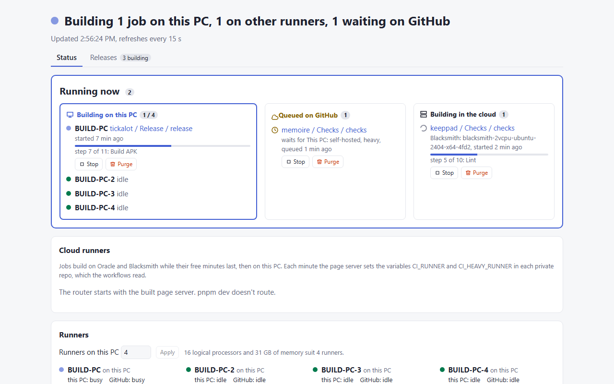
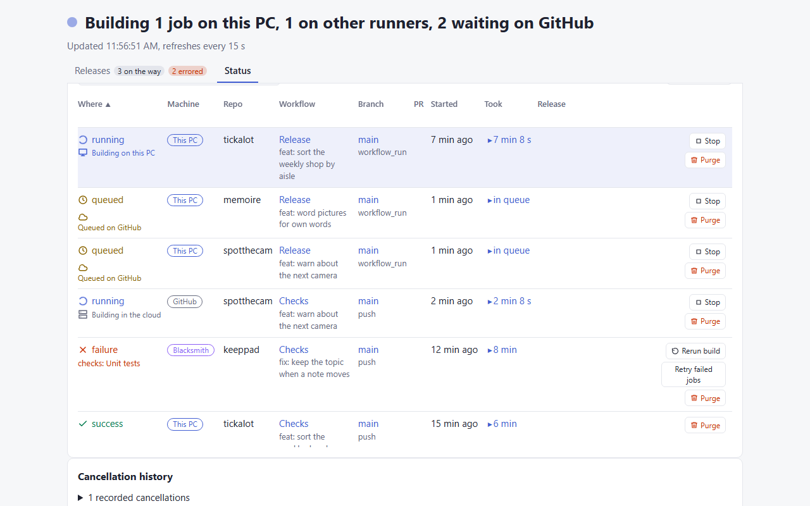
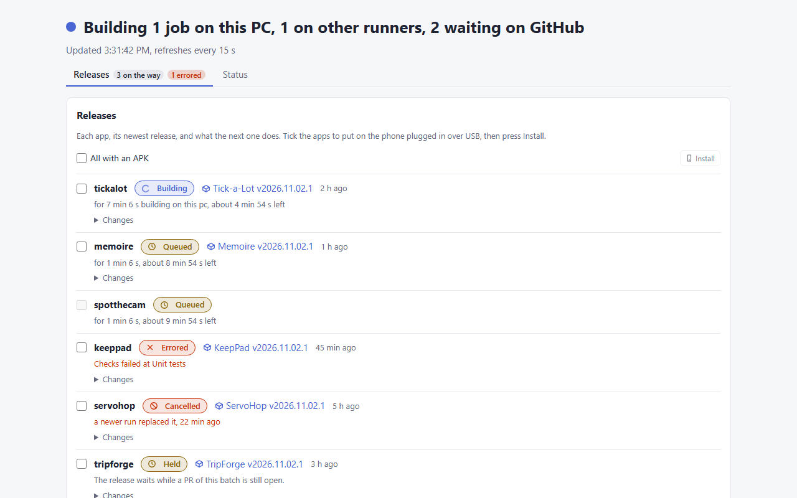

# local-ci

One script gives a Mac or a Windows PC the same dev tools. A second script can
then make the machine a self-hosted GitHub Actions runner. CI of the
`workbench-soft` repos then builds there for free. Software that IT manages
stays out of both.

On a Mac:

```sh
git clone https://github.com/workbench-soft/local-ci.git
./local-ci/install.sh
```

On Windows, in PowerShell:

```powershell
git clone https://github.com/workbench-soft/local-ci.git
.\local-ci\install.ps1
```

- **Run it again** each script skips the pieces already in place.
- **Fresh Windows** install Git first: `winget install Git.Git`.
- **Old name** the `mac-setup` address redirects here.

## Screenshots

<p>
</p>
<p></p>

`mise run demo` takes them again from `next dev`, with made up runs and runners from `dashboard/demo/fake-github.ts`.

## CI runner

The last question of each installer is whether to register the machine as a
runner. The runner scripts also work alone:

| Machine | Script | Labels | Starts |
| --- | --- | --- | --- |
| Mac | `runner/install.sh` | `self-hosted, macOS, ARM64, android, local` | launchd service while logged in |
| Windows | `runner/install.ps1` | `self-hosted, Windows, X64, local` | scheduled task at boot, before anyone logs in |

- **Token** the script gets a registration token from `gh api`. A login
  without the `admin:org` scope gets the runner settings URL to copy a token
  from.
- **Checksum** the script checks the download against the SHA256 in the
  runner release notes.
- **After a reboot** the Windows runner starts at boot as you, before anyone
  logs in. Setting that up takes admin rights, so the script asks Windows once.
- **Priority** the boot task runs at normal priority, and `Runner.Listener`
  and `Runner.Worker` start above normal through their `PerfOptions` key in
  the registry. At 100% CPU they still reach GitHub, where below normal
  runners went offline. Build steps run at normal.
- **Watchdog** a runner that GitHub shows offline 10 minutes after its task
  started gets a restart: from the update task every 5 minutes, and from
  `START.cmd`. `windows\runner-watchdog.ps1` holds the check.
- **Errors and log** the admin window of `runner\install.ps1` stays open on
  an error until you press Enter. Each admin run writes its output to
  `~/actions-runner/install.log`.
- **Git Bash** the task starts `start.cmd`, which puts Git Bash first on PATH.
  Without it `shell: bash` would get the WSL bash from WindowsApps.
- **GitHub access** jobs on Windows see mise and `~/.gitconfig`. The `gh`
  login in the Windows credential store stays out of reach, so use the job's
  `GITHUB_TOKEN`.
- **Several runners** a runner takes one job at a time. Windows gets 4
  runners and a Mac 1, so Windows builds 4 jobs at once. `RUNNER_COUNT` picks
  another number. Jobs speed up only when the workflow splits its work into
  jobs or a `matrix`.
- **Count from the page** on Windows the Runners card of the status page
  sets the count and shows the count this PC suits: 1 runner per 4 logical
  processors and per 4 GB of memory past 8 GB. Apply saves it in
  `~/actions-runner/runner-count` and starts the task
  `GitHub Actions runner count (workbench-soft)`. The task runs
  `runner\install.ps1` as admin in a window on your desktop.
- **Tool cache** the runners share `~/actions-runner/_tool`, so a `setup-*`
  action downloads node, Java or Python once per machine. A rerun of the
  script moves old runners onto it.
- **pnpm store** every job uses the machine's pnpm store through
  `pnpm_config_store_dir`, so `pnpm install` downloads a package once.
- **Defender** `windows\defender-exclusions.ps1` holds every Defender
  exclusion: the runner folders, `C:\ci`, `DEV_DIR`, and the Gradle, Cargo,
  sccache, pnpm, npm and mise caches. The runner script calls it, and it also runs
  alone. Add a path there. `RUNNER_DEFENDER_EXCLUSIONS=off` skips it.
- **Long paths** the script sets `git config --global core.longpaths true`
  and, in an admin run, `LongPathsEnabled` in the registry. `node_modules`
  and the `.open-next` cache hold paths over 260 characters.
- **Work folder clean** before each job, `runnerclean-work.ps1` deletes the
  runner's repo checkouts in `C:ci<n>` unused for 3 days, and all but the
  current one when the drive has under 60 GB free. `RUNNER_CLEAN_DAYS` and
  `RUNNER_CLEAN_MIN_FREE_GB` change the limits.
- **Clean by hand** double click `CLEAN-CI.cmd` in the repo root to empty
  `C:ci` at once. The runners stop for a few seconds, and the old files
  delete in the background at idle priority.
- **Folders** the first runner sits in `~/actions-runner/workbench-soft`, the
  next in `workbench-soft-2` and up. `RUNNER_ORG` picks another org.
- **Fewer runners** on Windows a lower count removes the runners above it
  from GitHub, with their boot tasks and folders. A runner on a job goes once
  the job ends. Removal needs `gh` with the `admin:org` scope. On a Mac a
  lower `RUNNER_COUNT` leaves the extra ones registered.
- **In a workflow** `runs-on: [self-hosted, local]` takes whichever machine is
  on. A job that needs macOS asks for `[self-hosted, macOS]`.
- **Heavy lane** the first 2 Windows runners also carry `heavy`. A job that
  runs Gradle, Cargo or Tauri asks for `[self-hosted, heavy]`, so at most 2
  such builds share the PC. 8 at once made a 10 minute release take 50.
  `RUNNER_HEAVY_COUNT` picks another number, and a rerun of the script fixes
  the labels on GitHub through `gh`.
- **Action cache** the runners copy each action's zip from
  `~/actions-runner/_actions-cache` in place of a download, so "Set up job"
  stops fetching `checkout` and the rest for each job. The runner only reads
  the folder. `runner/cache-actions.ps1` fills it from the `uses:` lines of
  the workflows under `DEV_DIR` and from the runner logs, through the GitHub
  API with the `gh` login. `runner/install.ps1` runs it. Run it again after
  a workflow pins a new action version.

## Start the CI

Double click `START.cmd` in the repo root. It moves the code to the newest
release and installs what changed, starts each runner and the page that isn't
running, then opens `http://localhost:4280`.

- **Same install as the task** it runs `windows\update.ps1`, and waits while
  the update task installs.
- **Admin prompt** shows when an installer runs or Windows refuses to start a
  task.
- **First run** it builds the page and adds the update task. Without a runner
  task, it names `runner\install.ps1`.

## Cloud runners first

Jobs build on Blacksmith, then Oracle, then GitHub runners while the free
minutes last, then on this PC. The status page server sets three variables in
each private repo, and each job reads one:

```yaml
runs-on: ${{ fromJSON(vars.CI_HEAVY_RUNNER || '["self-hosted","heavy"]') }}
```

| Lane | Variable | 1 | 2 | 3 | 4 |
| --- | --- | --- | --- | --- | --- |
| Light: lint, tests | `CI_RUNNER` | Blacksmith 2 vCPU | Oracle VM | `ubuntu-latest` | `[self-hosted, local]` |
| Heavy: Gradle, Cargo, Tauri | `CI_HEAVY_RUNNER` | Blacksmith 4 vCPU | | `ubuntu-latest` | `[self-hosted, heavy]` |
| Windows builds | `CI_WINDOWS_RUNNER` | Blacksmith 2 vCPU Windows | | `windows-latest` | `[self-hosted, heavy]` |

- **Blacksmith** on once the Blacksmith app is installed in the org at
  [app.blacksmith.sh](https://app.blacksmith.sh). The page stops at 2700 of
  the 3000 free minutes, since Blacksmith bills past 3000.
  `BLACKSMITH_BUDGET` in `dashboard\.env.local` changes the stop.
- **Oracle** create an Always Free Ampere A1 VM with Ubuntu, then run
  `./runner/oracle.sh ubuntu@<vm address>` from Git Bash on this PC. Heavy
  and Windows jobs skip it, since Android and Windows don't build on ARM.
- **GitHub** the org gets 2000 free minutes a month, Windows counted twice
  and macOS 10 times. The page reads every repo from the billing API, adds
  the jobs running on GitHub now, and stops 300 minutes short, at 1700.
  `GITHUB_FREE` and `GITHUB_MARGIN` in `dashboard\.env.local` change it.
- **Stuck** a job queued on Blacksmith for 5 minutes turns Blacksmith off for
  an hour, and its run starts again on the next runner in line.
- **Off** `CLOUD_ROUTER=off` in `dashboard\.env.local` stops the router. The
  variables keep their last value.
- **Fixed jobs** a job that needs files or a login on this PC keeps its PC
  labels, such as `translate` of guitar-upscale.

## CI status page

`http://localhost:4280` shows what builds on this PC and what waits on GitHub.
The page starts with Windows and opens in the browser at each logon. Set it up
once, from the main checkout:

```powershell
.\dashboard\install.ps1
```

- **Shows** the jobs on this PC, the jobs waiting on GitHub for a runner, the
  org runners, the cloud routes, and the latest runs with the machine of each
  run, a filter and sorting.
- **Stop and Purge** each run gets a Stop button to force cancel it, so its
  runner is free at once. The button reads Stopping, then Stopped. A Purge
  button force cancels a run and deletes it from GitHub with its logs.
  Purge all, after a confirm, purges every run the filter and search match,
  older runs included, until none match.
- **Rerun failed builds** the Status tab offers `Rerun build` to rerun the full
  workflow, or `Retry failed jobs` to rerun only the failed jobs. The Releases
  tab also has `Rerun build` for errored releases. The existing server-side
  GitHub token needs Actions write access; no token is sent to the browser.
  Purge all, after a confirm, purges every run the filter and search match,
  older runs included, until none match.
- **Replaced builds** the server cancels an active build only when a newer
  push builds a different commit in the same repo, workflow, branch and event.
  Closing a PR alone keeps the build. Failed Checks stop releases of the same
  commit. The cancellation history links the causing build, commit and PR.
  Requests are saved before GitHub is called. `CANCEL_SUPERSEDED=off` in
  `dashboard\.env.local` turns it off. A rerun of the install script keeps it.
- **Release and Install** a run that published a release links to it in the
  Release column. Install puts its APK on the phone plugged in over USB,
  through `adb install -r`. adb comes from `ADB_PATH`, `PATH` or the
  Android SDK.
- **Releases tab** opens by default at `http://localhost:4280`, with Status
  one click away at `/?tab=status`. Each app shows the state of its release:
  released, building, queued, errored, cancelled, held while a session PR is
  open, or no release yet. A building or queued row says how long the run
  took so far and, when past runs give the usual time, how long until the
  release. A cancelled row says why: each force cancel, from the page or from
  the sweep that kills replaced runs, writes its reason to
  `dashboard\cancel-reasons.jsonl`. The newest release of each app sits
  beside its state with its notes under Changes. Tick several apps and
  press Install to put their APKs on the phone one after another.
- **Errors** a failed run names its failed job and step, linked to the log. A
  failed install shows adb's error in a red box under the button.
- **Links** the branch and the PR of each run open on GitHub.
- **Opens** after the install build, and at logon through a shortcut in the
  Startup folder. Delete `local-ci dashboard.lnk` there to stop it.
- **Token** the boot task can't read the gh login, so the script copies
  `gh auth token` into `dashboard\.env.local`.
- **Rerun** after a `git pull` or a new gh login. The script rebuilds the page
  and restarts it.
- **In the launcher** the CI tab of the Workbench launcher frames the page.
  Other sites can't frame it, so none can steer a click onto Stop.
- **Develop and test** in `dashboard`, `mise x -- pnpm dev` serves the page on
  port 4281 and cancels no run. `mise x -- pnpm typecheck` and
  `mise x -- pnpm test` are the checks.
- **CI** `.github/workflows/checks.yml` runs those checks, a build, shellcheck,
  shfmt and a parse of each `.ps1` file on the Windows runners, for each push
  to `main`. PR runs are off, so run the checks before a merge.
- **Logs** `dashboard\dashboard.log`.

## Releases

Each push to `main` that passes Checks gets a release on the
[Releases page](https://github.com/workbench-soft/local-ci/releases), such as
`v2026.10.30.1`. Its notes list the commits since the release before.
`START.cmd` and the update task install the newest release.
Release starts alongside Checks; publication alone waits for the matching
commit's successful checks. Open PRs hold no release build.

From the Releases tab, **Release on CI** dispatches a supported app workflow
on `main`. **Build locally** fetches the latest `main` of memories-mobile,
Shuttrix, Tick-a-Lot, SkyAltar, Memoire, Shuttrix Legacy or SpotTheCam and builds its APK
in a temporary clone. The build uses the app's local release key when it is
set up on this PC. **Install local** sends that APK to the connected phone.
Tick a published APK and press **Install** to install a CI release instead.
ADB needs one authorized phone; local builds also need the app clone and its
Android SDK.

**Clean old APK releases & artifacts** on the Releases tab previews storage use across
all non-archived organization repositories, then asks for confirmation. It
removes completed GitHub Actions artifacts without deleting workflow runs or
logs, and old APK-bearing releases from the shared releases repo. The newest
published APK release for **each** app stays available; non-APK releases,
prereleases and drafts stay unchanged. Active run artifacts are protected.
The page shows deletion progress and reports permission or quota errors.
The local dashboard uses its server-side GitHub token; it must have Actions
write access on the app repositories and Contents write access on the shared
releases repository. The quota display may lag after cleanup.

## Updates by themselves

The Windows PC installs each new release on its own. The `local-ci update`
task runs every 5 minutes and at logon, so a release lands within 5 minutes.

- **What it runs** `windows\update.ps1` moves the checkout to the newest
  release tag. Then it runs `dashboard\install.ps1` or `runner\install.ps1`
  when their files changed.
- **Turn it on** double click `START.cmd` once. `dashboard\install.ps1` and
  `windows\update.ps1 -Register` add the task too.
- **One at a time** the task and `START.cmd` share a lock file,
  `~/.local-ci/install.lock`. The task skips its turn while the lock is held.
- **Log** `~/.local-ci/update.log`.
- **Local edits** the merge stashes an edited file, such as `TODO.md`, and
  puts it back after. An edit that clashes with the release stays in the
  stash, and `update.log` says so.
- **Skipped** a checkout on another branch and the dev tools of the root
  `install.ps1`.

## Windows

[winget](https://learn.microsoft.com/windows/package-manager/winget/) stands in
for Homebrew. It installs git, gh, mise, fzf, jq, shellcheck, shfmt, mkcert,
VS Code, Docker Desktop, Claude and the Android platform tools. npm adds
`agent-browser`.

`install.ps1` leaves out the Mac only pieces:

- **Oh My Zsh** the PowerShell 7 profile gets `mise activate pwsh` in its
  place. Windows PowerShell 5.1 reaches node and pnpm through the mise shims on
  PATH.
- **Maccy** Windows has its own clipboard history under Win+V.
- **terminal-notifier and gh-review-notify** both depend on macOS
  notifications.
- **twg** its installer is a bash script for macOS.

- **Repos** land in `WBS_ROOT`, by default the folder that holds the
  `local-ci` clone. `DEV_DIR` still works in its place.
- **Line endings** git gets `core.autocrlf input` on top of the Mac config.
  Checkouts keep LF, so bash scripts run on the Windows runner.

## Homebrew (Mac)

[brew.sh](https://brew.sh) is the source. A Mac without Homebrew gets it from
the script first.

| Formula | Why |
| --- | --- |
| [git](https://formulae.brew.sh/formula/git) | newer than the one Apple ships |
| [gh](https://formulae.brew.sh/formula/gh) | GitHub CLI |
| [mise](https://formulae.brew.sh/formula/mise) | node, pnpm, yarn and Python 3.15 versions per project. On Windows a `python3` forwarder in `.local/bin` of the home folder runs the same Python |
| [fzf](https://formulae.brew.sh/formula/fzf) | the branch picker behind `git sb` |
| [jq](https://formulae.brew.sh/formula/jq) | git-aliases and gh-review-notify read JSON with it |
| [shellcheck](https://formulae.brew.sh/formula/shellcheck) | `lint.sh` in git-aliases calls it |
| [shfmt](https://formulae.brew.sh/formula/shfmt) | the same `lint.sh` formats with it |
| [terminal-notifier](https://formulae.brew.sh/formula/terminal-notifier) | gh-review-notify shows macOS notifications with it |
| [mkcert](https://formulae.brew.sh/formula/mkcert) | HTTPS certificates for local servers |
| [agent-browser](https://agent-browser.dev/) | a browser that coding agents drive |

| Cask | Why |
| --- | --- |
| [visual-studio-code](https://formulae.brew.sh/cask/visual-studio-code) | editor |
| [docker-desktop](https://formulae.brew.sh/cask/docker-desktop) | containers |
| [maccy](https://formulae.brew.sh/cask/maccy) | clipboard history |
| [claude](https://formulae.brew.sh/cask/claude) | the Claude desktop app |
| [android-platform-tools](https://formulae.brew.sh/cask/android-platform-tools) | adb, for testing on a phone |

## Node toolchain

[mise](https://mise.jdx.dev) sets the global versions:

```sh
mise use -g node@22 pnpm@latest yarn@1
```

[sccache](https://github.com/mozilla/sccache) wraps rustc through the global
mise env, so each worktree reuses the crates another one compiled:

```sh
mise use -g github:mozilla/sccache@0.19
mise set -g RUSTC_WRAPPER=sccache SCCACHE_CACHE_SIZE=20G
```

One npm global goes on top: the Copilot CLI,
[`@github/copilot`](https://www.npmjs.com/package/@github/copilot).

## Git

The script sets this global config:

```sh
git config --global color.ui true
git config --global push.autosetupremote true
```

- **Name and email** the first run asks for `user.name` and `user.email`. The
  script itself holds no personal data.
- **Aliases** come from
  [workbench-soft/git-aliases](https://github.com/workbench-soft/git-aliases).
  Its own `install.sh` adds the `include.path` and offers to source
  `git-sb.zsh`.
- **Why a separate wrapper** `git sb` can switch to a branch in another
  worktree. Only a shell function can `cd` the parent shell there.

## Shell

- **Oh My Zsh** from [ohmyz.sh](https://ohmyz.sh), with the default
  `robbyrussell` theme and the `git` plugin.
- **`~/.local/bin` on PATH** for the CLIs I write myself.
- **`mise activate zsh`** in `.zshrc`.

## My repos

They are private in `workbench-soft`, so the script logs into `gh` first. Then
`gh repo clone` puts each one in `~/Documents/Dev`, and the repo's own
`install.sh` installs it:

| Repo | What it gives |
| --- | --- |
| [git-aliases](https://github.com/workbench-soft/git-aliases) | short git commands: `git sb`, `git db`, `git m` and more |
| [agent-skills](https://github.com/workbench-soft/agent-skills) | Copilot skills: writing-style, review, create-pr, implement-ticket, address-comments |
| [gh-review-notify](https://github.com/workbench-soft/gh-review-notify) | a macOS notification for each new PR review comment, from a LaunchAgent |

## GitHub CLI

```sh
gh auth login
gh extension install github/gh-stack
```

[gh-stack](https://github.com/github/gh-stack) handles stacked PRs.

## Teamwork Graph CLI

`twg` reads and writes Jira and Confluence, for you in the terminal and for
agents. The source is
[teamwork-graph.atlassian.com](https://teamwork-graph.atlassian.com).

```sh
bash <(curl -fsSL https://teamwork-graph.atlassian.com/cli/install)
```

- **Install** the installer puts `twg` in `~/.local/bin`. It asks you to accept
  Atlassian's terms and to log in.
- **Updates** it adds the `com.atlassian.twg.upkeep` LaunchAgent. That agent
  runs `twg upkeep` every 12 minutes to keep the CLI current.
- **Skip npm** the package there is too old to run.

## VS Code extensions

- [anthropic.claude-code](https://marketplace.visualstudio.com/items?itemName=anthropic.claude-code)
- [dbaeumer.vscode-eslint](https://marketplace.visualstudio.com/items?itemName=dbaeumer.vscode-eslint)
- [esbenp.prettier-vscode](https://marketplace.visualstudio.com/items?itemName=esbenp.prettier-vscode)
- [formulahendry.auto-rename-tag](https://marketplace.visualstudio.com/items?itemName=formulahendry.auto-rename-tag)
- [huizhou.githd](https://marketplace.visualstudio.com/items?itemName=huizhou.githd)
- [nrwl.angular-console](https://marketplace.visualstudio.com/items?itemName=nrwl.angular-console)
- [oleg-chibikov.open-in-remote-repo](https://marketplace.visualstudio.com/items?itemName=oleg-chibikov.open-in-remote-repo)
- [orta.vscode-jest](https://marketplace.visualstudio.com/items?itemName=orta.vscode-jest)

## MCP servers

[mcp-config.json](./mcp-config.json) wires the Atlassian and GitHub MCP
servers. The script copies it to `~/.copilot/mcp-config.json` when that file
is missing.

## Claude Code memory

[claude/MEMORY.md](./claude/MEMORY.md) holds notes that Claude Code reads in
every project:

- **pnpm version** mise pins it per repo, from `packageManager`.
- **`GH_PAGER=cat`** stops `gh` from opening a pager that hangs the agent.
- **Review asks** load the `review` skill from agent-skills first.

The script copies the file to `~/.claude/MEMORY.md` when that file is missing.
It also imports it at the top of `~/.claude/CLAUDE.md`. The agent-skills
installer adds the writing-style import to the same file.

## Left to do by hand

- **Secrets** live in Bitwarden Secrets Manager, project `workbench-soft`, and no dotfile holds them.
