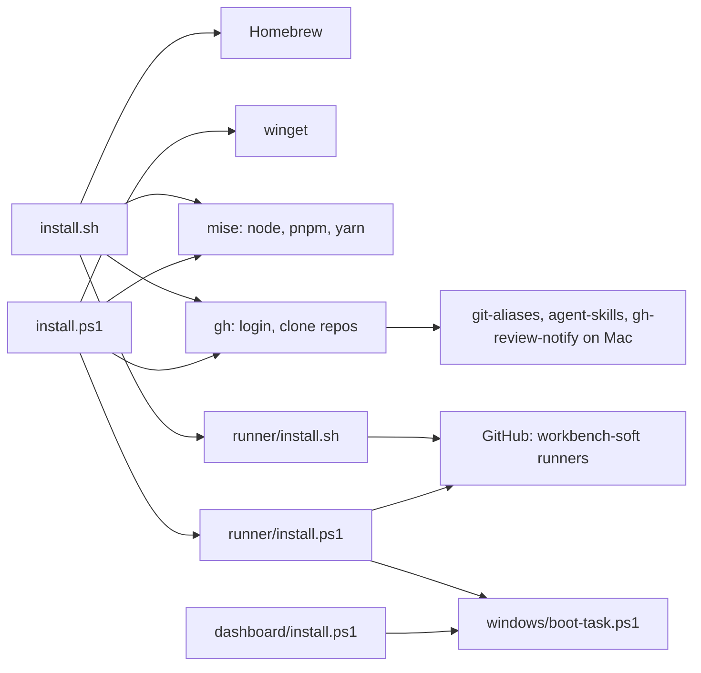
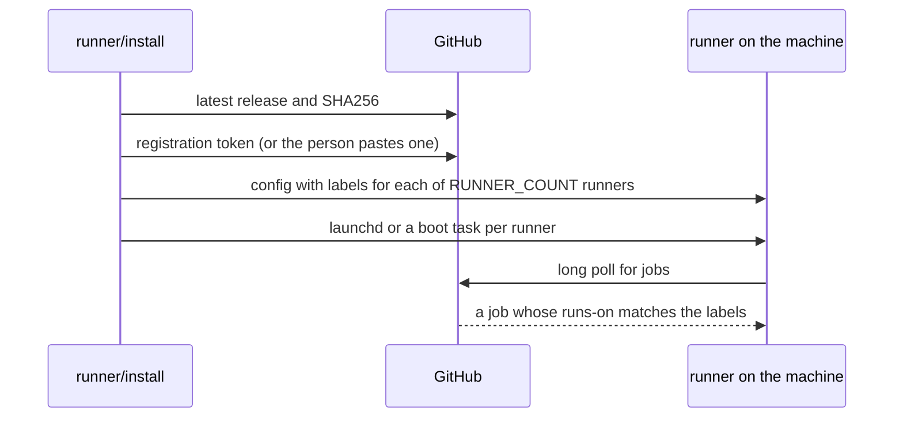
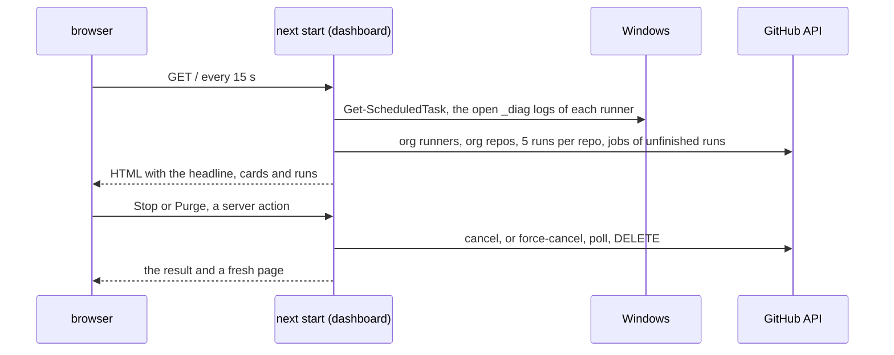

# Architecture

local-ci is a set of scripts and one local web page. Each script runs on the
machine it sets up, and it talks to package managers and GitHub. The page in
`dashboard/` shows the runner and the latest runs.

## Modules

- **Machine setup** `install.sh` sets up a Mac with Homebrew, mise, Oh My Zsh
  and the repos. `install.ps1` sets up Windows with winget, mise and the repos.
- **Runner setup** `runner/install.sh` registers a Mac as a GitHub Actions
  runner, and `runner/install.ps1` does the same for a Windows PC.
- **Boot task** `windows/boot-task.ps1` holds the admin check and the
  scheduled task that both Windows boot scripts use.
- **Start button** `START.cmd` runs `windows/start.ps1`. The script starts
  the runner and page tasks that aren't running, then opens the page.
- **Status page** `dashboard/` is a Next.js app. `dashboard/install.ps1`
  builds it and starts it at boot.
- **Data files** `mcp-config.json` and `claude/MEMORY.md`, copied into the
  home folder when missing.

## Outside services

| Service | Used for |
| --- | --- |
| Homebrew, winget | tools and apps |
| npm through mise | the Copilot CLI and agent-browser |
| GitHub API | the clones, the runner release and its registration token, the runners and runs on the status page |
| `github.com/actions/runner` releases | the runner download and its SHA256 |

## How a runner gets a job

## How the status page gets its data

The server renders the page for each request.

- **This PC** `status/this-pc.ts` finds each runner folder of the org. For
  each it reads the boot task and which `_diag` logs a live process holds open.
- **GitHub** `status/org-status.ts` calls the API with the token from
  `.env.local`. It keeps the answer in memory for 20 seconds, and requests
  that arrive during a load wait for that load. For each unfinished run it
  also reads the jobs, with the runner that took each one.
- **Place** `status/placement.ts` puts each job on this PC, on another runner
  or in the GitHub queue. A job is local when its runner name matches the
  `agentName` in a runner folder's `.runner` file.
- **Runners** `status/runners.ts` joins the runner folders of this PC with
  the org runners on GitHub by name, and adds a hint where the two disagree.
- **Headline** `status/headline.ts` turns all that into the headline and the
  dot colors. The cards in `cards/` draw the rest. The runs table filters and
  sorts in the browser.
- **Open at logon** the boot task runs without a desktop. A shortcut in the
  Startup folder runs `dashboard/open.ps1`, which waits for the port and opens
  the page.
- **Stop and Purge** the buttons call server actions in
  `status/run-actions.ts`. Stop posts to `/actions/runs/{id}/cancel`. Purge
  runs `status/purge.ts`: it posts to `force-cancel`, polls the run until it
  is completed, then sends `DELETE` on the run. Each action drops the cache.
- **Repo errors** a repo whose runs call fails drops out of the list, and the
  other repos still show.

