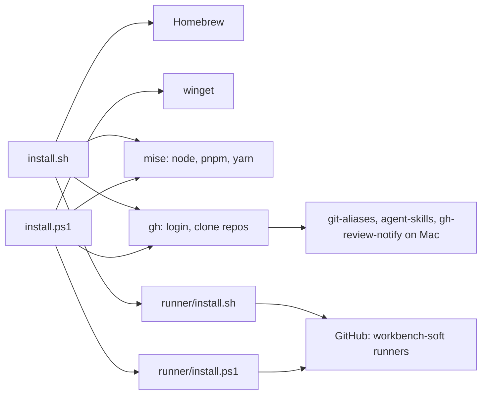
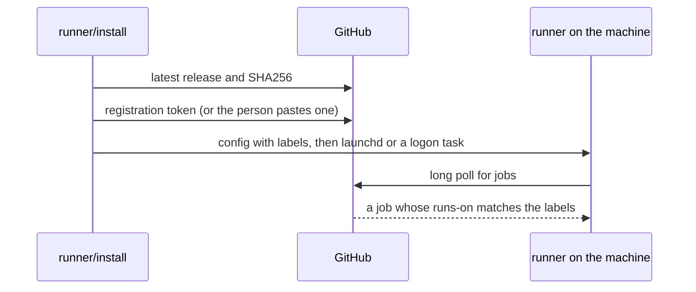

# Architecture

local-ci is a set of scripts with no server. Each script runs on the machine
it sets up and talks to package managers and GitHub.

## Modules

- **`install.sh`** sets up a Mac with Homebrew, mise, Oh My Zsh and the repos.
- **`install.ps1`** sets up Windows with winget, mise and the repos.
- **`runner/install.sh`** registers a Mac as a GitHub Actions runner.
- **`runner/install.ps1`** registers a Windows PC as a GitHub Actions runner.
- **Data files** `mcp-config.json` and `claude/MEMORY.md`, copied into the home
  folder when missing.

## Outside services

| Service | Used for |
| --- | --- |
| Homebrew, winget | tools and apps |
| npm through mise | the Copilot CLI and agent-browser |
| GitHub API | the clones, the runner release and its registration token |
| `github.com/actions/runner` releases | the runner download and its SHA256 |

## How a runner gets a job

