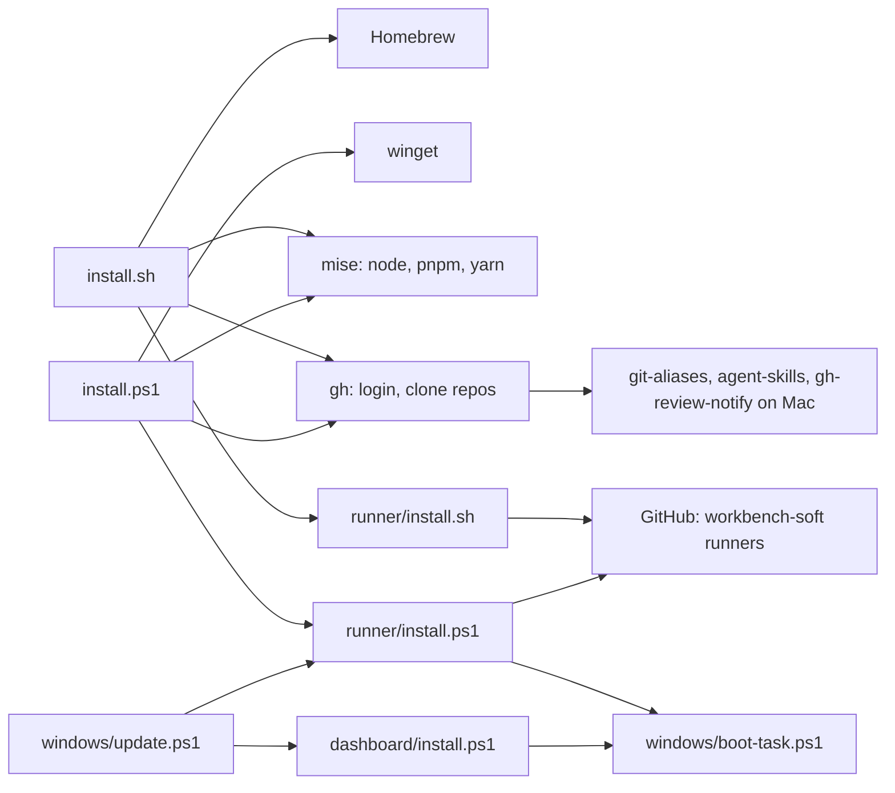
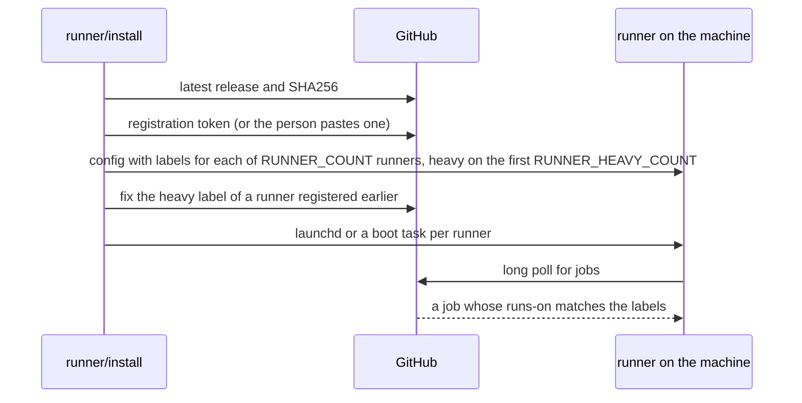
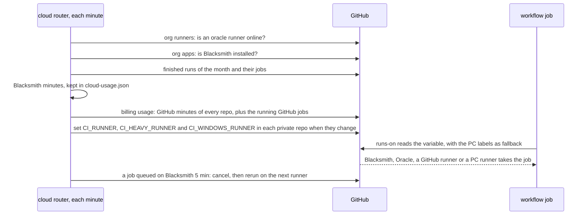
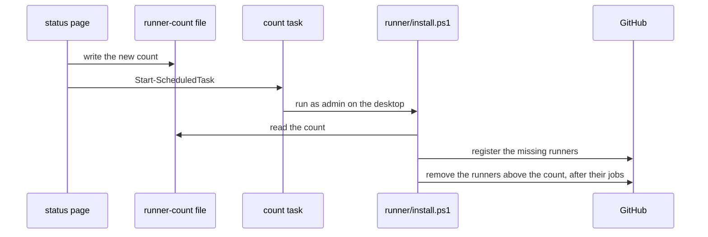
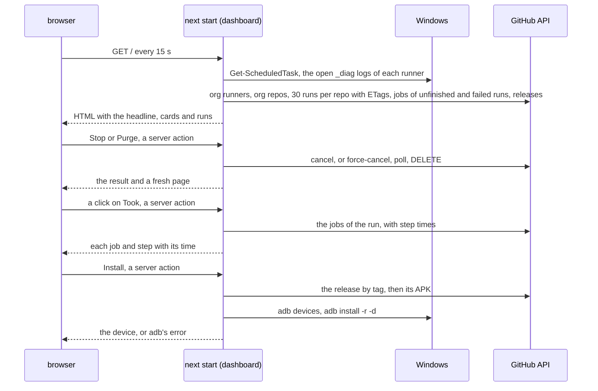

# Architecture

local-ci is a set of scripts and one local web page. Each script runs on the
machine it sets up, and it talks to package managers and GitHub. The page in
`dashboard/` shows the runner and the latest runs.

## Modules

- **Machine setup** `install.sh` sets up a Mac with Homebrew, mise, Oh My Zsh
  and the repos. `install.ps1` sets up Windows with winget, mise and the repos.
- **Runner setup** `runner/install.sh` registers a Mac as a GitHub Actions
  runner, and `runner/install.ps1` does the same for a Windows PC. On
  Windows it keeps the count in `~/actions-runner/runner-count`, removes the
  runners above it and registers the count task the status page starts.
- **Boot task** `windows/boot-task.ps1` holds the admin check and the
  scheduled task that both Windows boot scripts use. The page task and the
  runner tasks run at normal priority.
- **Start button** `START.cmd` runs `windows/start.ps1`. The script takes
  the install lock, runs `windows/update.ps1 -FromStart`, adds the update task
  when it is missing, starts the runner and page tasks that aren't running,
  then opens the page.
- **Watchdog** `windows/runner-watchdog.ps1` asks GitHub which runners are
  offline. A runner task that runs, started over 10 minutes ago and whose
  runner is offline gets stopped, its listener ended and the task started
  again. The update task runs it ahead of the install lock, and `START.cmd`
  runs it in its admin window.
- **Install lock** `Enter-InstallLock` in `windows/boot-task.ps1` holds
  `~/.local-ci/install.lock` open. The update task skips its turn while
  `START.cmd` holds it, and `START.cmd` waits while the task holds it.
- **Status page** `dashboard/` is a Next.js app. `dashboard/install.ps1`
  builds it and starts it at boot. The build goes to `.next-a` or `.next-b`,
  the folder the running page doesn't serve, and `start.cmd` names the folder
  in `NEXT_DIST_DIR`. The page stops only for the swap, so the sweep of
  replaced runs keeps going through a build.
- **Release controls** `dashboard/status/release-actions.ts` dispatches an
  app's release workflow on `main`. `status/local-build-runner.ts` fetches the
  app's latest `main`, builds in a temporary clone and retains only its APK.
  `status/local-build.ts` installs that APK through ADB. Local build clones
  are removed after the build; uninstalled APKs expire after 6 hours.
- **Updates** `windows/update.ps1` moves the checkout to the newest release
  tag. It runs `dashboard/install.ps1` when `dashboard/` moved past
  `dashboard/.built-commit`, and `runner/install.ps1` when the runner files
  moved past `~/.local-ci/runner-commit`. The `local-ci update` task runs it
  every 5 minutes and at logon. It also starts the page task when no process
  listens on the page's port.
- **Data files** `mcp-config.json` and `claude/MEMORY.md`, copied into the
  home folder when missing.

## Outside services

| Service | Used for |
| --- | --- |
| Homebrew, winget | tools and apps |
| npm through mise | the Copilot CLI and agent-browser |
| GitHub API | the clones, the runner release and its registration token, the runners and runs on the status page, release dispatches and storage cleanup, the variables `CI_RUNNER`, `CI_HEAVY_RUNNER` and `CI_WINDOWS_RUNNER` |
| adb | installs APKs on the phone plugged in over USB, and sends the Install Dev unlock link |
| Blacksmith | cloud runners for the org, 3000 free 2 vCPU minutes a month |
| Oracle Cloud | an Always Free ARM VM that runs `oracle` runners |
| `github.com/actions/runner` releases | the runner download and its SHA256 |

## How a runner gets a job

## How a job picks its machine

## How the page changes the runner count

## How the status page gets its data

The server renders the page for each request.

- **Host check** `proxy.ts` answers 421 to a request whose Host isn't
  `localhost`, `127.0.0.1` or `[::1]`, so a rebound site name can't reach the
  server actions. `next.config.ts` forbids framing.
- **Runner count** `status/this-pc.ts` reads `runner-count`, the logical
  processors and the memory. `status/runner-count.ts` turns them into the
  recommended count. The Apply button calls `status/runner-count-action.ts`,
  which writes `runner-count` and starts the task
  `GitHub Actions runner count (<org>)`. That task runs `runner/install.ps1`
  as admin in the session of the logged on person.
- **This PC** `status/this-pc.ts` finds each runner folder of the org. For
  each it reads the boot task and which `_diag` logs a live process holds open.
  One PowerShell call reads them all, gives up after 15 s and keeps its
  answer for 5 s. Up to 30 s the page shows that answer at once while one new
  call runs behind it. A failed call keeps the last answer for up to a minute.
- **GitHub** `status/org-status.ts` calls the API with the token from
  `.env.local`, and each call gives up after 20 s. It keeps the answer in
  memory for 20 seconds, and requests that arrive during a load wait for that
  load. An older answer, up to 2 minutes, still serves at once while one new
  load runs. The caches sit on `globalThis`, since Next bundles the module
  once for the page and once for the sweep. Each repo call reads 30 runs.
  The page keeps the latest 5 and every unfinished one, so a run that builds
  under a pile of newer queued runs stays on the page. For each unfinished
  run it also reads the jobs, with the runner that took each one. The jobs of
  a queued run stay in memory while its `updated_at` holds, for up to 60 s.
- **App releases** no list names the apps. `status/release-workflow.ts`
  takes the workflow whose run published the app's newest release, found in
  the repo's runs of the 6 hours before it. A file named for a release or
  deploy, then a workflow whose YAML has `workflow_dispatch` and
  `gh release create`, answer when no run does. Each input keeps its default.
  `status/local-build-target.ts` finds `scripts/build-apk.sh` in the app's
  clone, at the root or in `apps/<app>`, and the APK in `dist/` beside it.
  A local build fetches `main` from the app clone, builds its APK in a temporary clone, and gives the ADB installer
  an opaque token; the client never receives the file path.
- **Rate limit** each GET sends back the ETag of its last answer. GitHub
  answers 304 when the data is the same, and a 304 costs no part of the 5000
  calls an hour.
- **Place** `status/placement.ts` puts each job on this PC, on another runner
  or in the GitHub queue. A job is local when its runner name matches the
  `agentName` in a runner folder's `.runner` file. `idleWhileQueued` finds
  runners of this PC that sit idle while a job with their labels waits over a
  minute.
- **Progress** for a workflow with a running job, `status/org-status.ts`
  reads the jobs of its 10 latest finished runs and keeps them in memory.
  `status/progress.ts` takes their Kaplan-Meier median, with cancelled and
  failed jobs as lower bounds, and turns it and the job's steps into the bar
  and the time left.
- **Runners** `status/runners.ts` joins the runner folders of this PC with
  the org runners on GitHub by name, and adds a hint where the two disagree.
- **Headline** `status/headline.ts` turns all that into the headline and the
  dot colors. The cards in `cards/` draw the rest. The runs table filters and
  sorts in the browser.
- **Open at logon** the boot task runs without a desktop. A shortcut in the
  Startup folder runs `dashboard/open.ps1`, which waits for the port and opens
  the page.
- **Stop and Purge** the buttons call server actions in
  `status/run-actions.ts`. Stop posts to `/actions/runs/{id}/force-cancel`,
  then the button asks `runFinished` every 2 seconds until the run is
  completed. Purge
  runs `status/purge.ts`: it posts to `force-cancel`, polls the run until it
  is completed, then sends `DELETE` on the run. Purge all sends the run ids
  the table matches, and `purgeRuns` purges them 5 at a time. The page holds
  5 runs per repo, so the button then reloads the page and purges the older
  runs that show, round after round, until none match. Each action drops the
  cache.
- **Old runs die** `instrumentation.ts` starts
  `status/cancel-superseded.ts` with the production server only. Every 10
  seconds it reads runs through the shared cache. `status/superseded.ts`
  compares commit identities within one repo, workflow, branch and event.
  PR closure alone cancels no run. Failed Checks or a failed Checks job stop
  active release workflows of the same repo, branch and SHA. The JSONL log
  saves requests before cancellation and then saves the result. A cancel
  GitHub refuses waits twice as long before each try, up to 5 minutes. Both tabs
  link the causing run, commit and PR from a shared history component.
- **Releases** the app repos are private, so their release workflows publish
  to the public `workbench-soft/workbench-soft.github.io` with the tag
  `<repo>-v<version>`. `status/releases.ts` gives each release to the run of
  its repo that ran while GitHub created it and ended nearest to it.
  `RELEASES_REPO` picks another repo. The call asks for
  `application/vnd.github.full+json`, so each release comes with its notes
  as cleaned HTML in `body_html`.
- **Releases tab** `/` by default, Status at `/?tab=status`.
  `status/latest-releases.ts` takes the app name from each tag, keeps the
  newest release per app and maps the app to its repo. The run that made
  the release names the app's release pipeline, the workflow that owns its
  releases. The runs of the repo on the default branch newer than the
  release decide the state, with runs of another app's pipeline in the same
  repo left out: the newest says released, building, queued, errored or
  cancelled, a skipped run of the pipeline says the gate held it, and a
  failed run that made the pipeline skip says errored. The wait is the
  whole life of the run so far, its queue time included, against the
  Kaplan-Meier usual life of the workflow's finished runs. A repo with runs
  and no release yet shows as an app once a workflow runs there after
  another one. `cards/releases-card.tsx` calls the install action once per
  ticked app, in turn. Each row is `cards/release-item.tsx`, with
  `release-buttons.tsx` and `release-detail.tsx`.
- **Cancel reasons** `status/cancel-log.ts` appends each force cancel to
  `dashboard/cancel-reasons.jsonl`: repo, run id, the words and the time.
  The sweep writes `A newer commit started the same build` or
  `Checks failed for this commit`, with the causing run, commit and PR. Stop
  and Purge write theirs, and the card reads the file back on each render.
  The append-only file keeps earlier evidence across restarts. `CANCEL_REASONS_FILE` in `.env.local`
  picks another file.
- **Install** `status/install-apk.ts` holds the server actions, and
  `status/adb.ts` the plain adb helpers a browser can't call. It checks
  `adb devices` for one phone, downloads the release's `.apk` to
  `%TEMP%\local-ci-apk`, runs `adb install -r -d` and deletes the file.
  adb's output goes back to the button on failure.
- **Install Dev** `installDeveloperRelease` installs the same APK, then
  `status/dev-phone.ts` reads the app id from the tag, such as
  `com.workbenchsoft.lumiere`, and builds the unlock link. The key comes from
  `WORKBENCH_DEV_KEY` and goes to `adb shell` through stdin, so it stays out
  of process arguments and the browser. The browser only learns whether the
  key is set.
- **Storage cleanup** `status/storage-cleanup-actions.ts` lists every artifact
  and APK release first, keeps a preview plan, then deletes in small batches
  after the confirm. `status/storage-cleanup.ts` keeps the newest APK
  release of each app.
- **Failed step** the page reads the jobs of failed runs too, with their steps.
- **Run times** the Took column is `updated_at` minus `run_started_at` for
  a finished run, from `status/durations.ts`. A click on it calls the
  `runTimings` server action, which reads the jobs of that run with the start
  and end of each step. The call shares the ETag of the jobs call, so an
  unchanged run costs no rate limit.
- **PR and branch** `pull_requests` of a run gives its PR links. The branch
  links to `/tree/<branch>`.
- **Repo errors** a repo whose runs call fails drops out of the list, and the
  other repos still show.

## Decisions

### CI host: self-hosted runners on the PC and the Mac

- **Picked** each machine registers as GitHub Actions runners for the
  `workbench-soft` org. Private repos run on `[self-hosted, local]`.
- **Why** the org repos are private, and jobs on these runners cost 0
  minutes. The org rule puts every private repo on this runner.
- **Trade-off** CI stops when the PC is off or loses the network. A job can
  get lost on a network drop, as `TODO.md` notes.
- **Rejected**
  - **GitHub hosted runners** a private repo pays for each minute past the
    free quota.
  - **Public repos** the repos moved to the org to become private.
- **This repo** it is public, so its own Checks and Release run on GitHub runners. A fork PR on the PC runner would run its code on the PC.
- **Cost to undo** high. The `runs-on` line of every workflow in every org
  repo changes.

### Cloud first: repo variables set by the page server

- **Picked** each job reads `runs-on` from a repo variable, and the status
  page server sets the variables in each private repo: Blacksmith, then
  Oracle, then GitHub runners while their free minutes last, then this PC.
  It writes them when the route changes, and checks every repo each 30
  minutes.
- **Why** builds load the PC the person works on. The variables cost no job,
  no minute and no change per repo when the route moves.
- **Trade-off** the count of Blacksmith minutes lags until a run finishes,
  so the stop sits at 2700 of 3000. The router runs only while the PC is on,
  and the variables then keep their last value.
- **Rejected**
  - **A route job in each workflow** each run would wait for an extra job,
    and a GitHub runner for it costs minutes.
  - **Blacksmith alone** it bills past 3000 minutes, with no hard stop.
  - **Oracle first** it has no minute limit, but it is one ARM VM. Blacksmith
    runs jobs side by side, so the person picked it first.
  - **Vercel CI** paid on Pro only, and it runs Turborepo tasks only.
  - **Org variables** GitHub Free hides them from private repos, so a job
    read the fallback labels and built on the PC.
  - **Public repos** unlimited GitHub minutes, but the repos moved to the
    org to become private.
- **Cost to undo** low. Unset the variables, and every job falls back to
  the PC labels.

### Runner start: a scheduled task as the person, not a service

- **Picked** each Windows runner starts from a boot task under the person's
  account. A Mac runner runs as a launchd service.
- **Why** a Windows service runs as NETWORK SERVICE. It lacks the person's
  mise, gh login and `~/.gitconfig`, which the jobs need.
- **Trade-off** Windows hides the runner's process path from the page. The
  page tells a live runner by the `_diag` logs it holds open.
- **Rejected**
  - **Windows service from `svc.cmd`** the wrong account, as above.
  - **Start by hand at logon** a reboot leaves the runners down.
- **Cost to undo** medium. `runner/install.ps1`, `windows/boot-task.ps1`
  and the This PC probe in `status/this-pc.ts` change.

### Several runners per PC, with a heavy lane

- **Picked** `RUNNER_COUNT` runners on one PC, 4 by default. The first 2
  carry the extra label `heavy`, and Gradle, Cargo and Tauri jobs ask for it.
- **Why** a runner takes one job at a time. With one runner, jobs waited in
  the queue while 16 cores sat free.
- **Trade-off** a heavy job waits for the PC, since the Mac runner has no
  `heavy` label. Light jobs also fill the heavy runners.
- **Rejected**
  - **One runner** jobs queue behind each other.
  - **Equal runners** 8 Gradle builds at once crawled. The keeppad release
    took 50 minutes, where a build alone takes 10.
- **Cost to undo** medium. The heavy jobs of each app repo name the label.

### Setup scripts: PowerShell on Windows, POSIX sh on the Mac

- **Picked** `install.ps1` and `runner/install.ps1` for Windows.
  `install.sh` and `runner/install.sh` for the Mac.
- **Why** an installer runs before Node exists on the machine. The org rule
  writes installers in POSIX sh. On Windows, winget, scheduled tasks and the
  Defender exclusions come through PowerShell.
- **Trade-off** each step exists twice, and the two scripts can drift.
- **Rejected**
  - **TypeScript run by Node** the org script default, but Node arrives only
    through mise, which the installer sets up.
  - **sh in Git Bash on Windows** scheduled tasks and Defender need
    PowerShell calls anyway.
- **Cost to undo** medium. Every installer gets rewritten.

### Status page: Next.js, rendered on the server

- **Picked** `dashboard/` is a Next.js app on `localhost:4280`. Server
  actions run PowerShell, adb and the GitHub calls.
- **Why** the page needs a process on the PC that keeps the GitHub token,
  reads the runner folders and runs `adb install`. A server render and server
  actions give that in one app. No source records why Next.js won.
- **Trade-off** the org stack names Vite for the web, so this app is off the
  list. Each update rebuilds it, and a Node process runs from boot.
- **Rejected**
  - **Vite page with its own API server** two processes to build and start
    for the same job.
  - **GitHub's Actions page** it shows one repo at a time, without this PC's
    runner folders.
- **Cost to undo** medium. The page and `dashboard/install.ps1` change. The
  runner scripts stay.

### Updates: move the checkout to the newest release tag

- **Picked** the `local-ci update` task runs `windows/update.ps1` every 5
  minutes, at logon and after each Release. It fast forwards to the newest
  tag and reruns only the installers whose files moved.
- **Why** each merge needed a `git pull` and an `install.ps1` run by hand,
  and `TODO.md` filled up with those steps.
- **Trade-off** a change waits for a green Checks and a release before the
  PC runs it.
- **Rejected**
  - **`START.cmd` pulls `main`** a double click during an update ran two
    builds in one folder. It could start a runner that `runner\install.ps1`
    was still setting up.
  - **Pull and install by hand** the steps piled up in `TODO.md`.
- **Cost to undo** low. `windows/update.ps1` and its task.

### GitHub data: polling with ETags and a shared cache

- **Picked** the server reads the API with `If-None-Match` and keeps each
  answer in memory for 20 seconds. Several tabs and the sweep share one load.
- **Why** the page ran out of its 5000 calls an hour on 2026-10-29 and
  showed no runs until the reset. A 304 costs no part of the limit.
- **Trade-off** the page lags GitHub by up to 20 seconds.
- **Rejected**
  - **A call per request** each tab and each refresh spent the limit.
  - **Webhooks** GitHub would need a public address that reaches the PC.
- **Cost to undo** low. `status/org-status.ts`.

### Old runs: GitHub cancels them, the page server sweeps the rest

- **Picked** two layers stop a run that a newer commit replaced.
  - **GitHub** Checks and each Release that builds on a push set `concurrency`
    with `cancel-in-progress: true`. The group is the workflow name with the
    PR number or the branch, so a newer push cancels the older run at once.
  - **Sweep** `status/cancel-superseded.ts` force cancels a run that a newer
    commit of the same repo, workflow, branch and event replaced.
- **Why** the queue filled with runs of replaced commits and merged PRs.
  They took runners to build code already replaced. On 2026-11-11 the page
  was down for an hour and old `memories` releases held all 8 runners, so
  the cancel now also sits in the workflows and works with the PC off.
- **Trade-off**
  - **GitHub** each repo holds the block, from the `repo-ci` templates. A
    run GitHub cancels has no line in `cancel-reasons.jsonl`, so its row
    shows no cause. A run by hand on `main` also cancels the push run of the
    same commit. A workflow with its own group, and the runs of a merged PR,
    stay for the sweep.
  - **Sweep** a run dies up to 30 seconds late, and only while the page
    server runs. Runs with unknown commit identities stay. Repeating the same
    commit keeps the running build.
  - **Publication** Release starts only once matching Checks pass, so a
    stopped dashboard cannot publish an unchecked build.
- **Kept apart** a Release run from `workflow_run` takes its run id as the
  group. It publishes one commit, and a newer push leaves it alone. A workflow
  that uploads or deploys in the run of the push keeps
  `cancel-in-progress: false`, such as `android.yml` of farnear.
- **Rejected**
  - **`concurrency` alone** it leaves the runs of merged PRs and the repos
    without the block.
  - **The sweep alone** the hour of 2026-11-11 above.
- **Cost to undo** low. Set `CANCEL_SUPERSEDED=off` in `.env.local`, or drop
  the block from the templates.

### Release of this repo: after Checks, through `workflow_run`

- **Picked** `release.yml` starts on `workflow_run` once Checks pass on a push
  to `main`. Releases wait in line in the `release` group.
- **Why** a Release that waited for Checks in a script held a runner, so
  Checks starved and releases timed out.
- **Trade-off** the release lands only after Checks end, a few minutes later
  than a build beside Checks.
- **Rejected**
  - **Release beside Checks, waiting in a step** the starved runners above.
  - **A release-gate build job** the repo builds no file to ship, so it has
    nothing to build ahead of Checks.
- **Cost to undo** low. `release.yml` alone.

### Runner speed fixes on Windows

- **Picked** a shared action cache, a shared Android SDK and short work
  folders under `C:\ci\<number>`.
- **Why** each one fixes a failure the runners hit:
  - **Action cache** "Set up job" took 1 to 3 minutes per job.
    `api.github.com` zipballs download at 650 KB/s against 10 KB/s from
    `codeload.github.com`.
  - **SDK installed once** two Gradle runs that downloaded into one SDK left
    NDK 27.1 broken. Jobs get `sdkDownload=false`.
  - **Short paths** Windows can't start a `.bat` past 260 characters, and
    Expo's CMake writes one deep inside `node_modules`.
- **Trade-off** a new action or SDK part needs a rerun of
  `runner\install.ps1`.
- **Rejected**
  - **Per job downloads** the slow "Set up job" and the broken SDK above.
- **Cost to undo** low. `runner/install.ps1` and `runner/cache-actions.ps1`.
