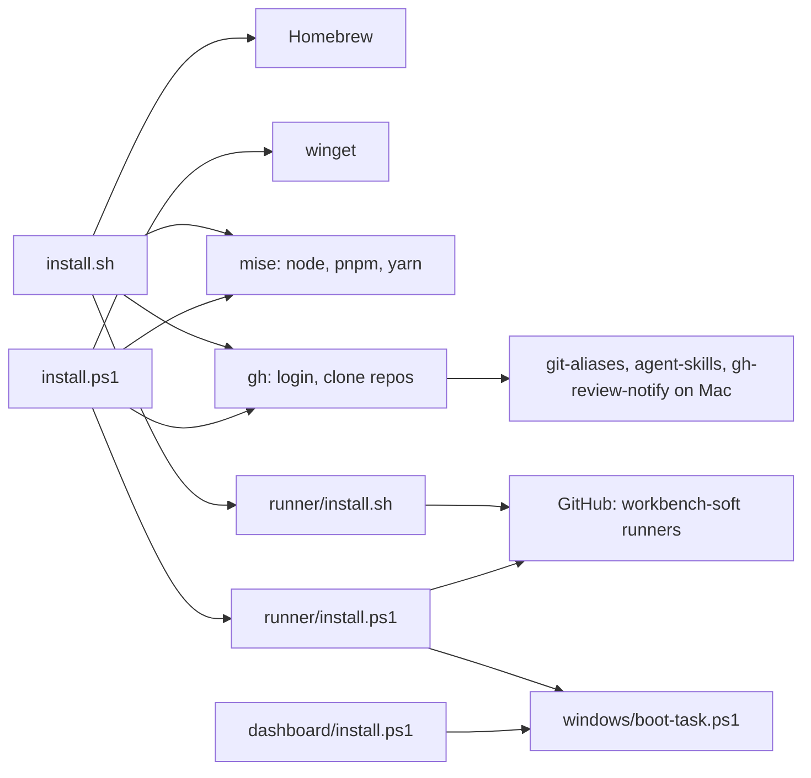
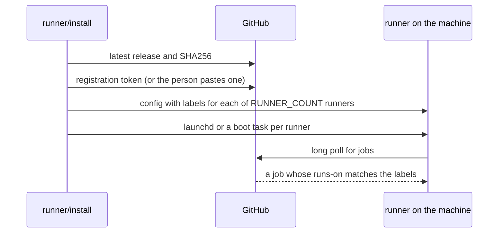
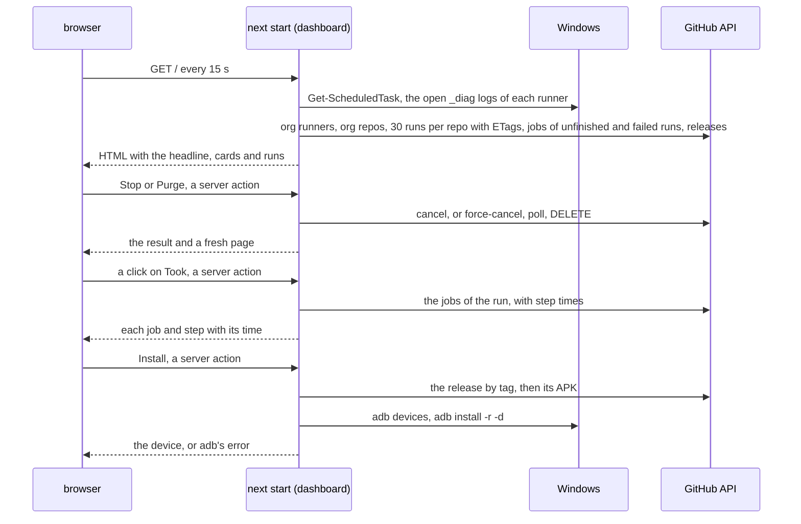

# Architecture

local-ci is a set of scripts and one local web page. Each script runs on the
machine it sets up, and it talks to package managers and GitHub. The page in
`dashboard/` shows the runner and the latest runs.

## Modules

- **Machine setup** `install.sh` sets up a Mac with Homebrew, mise, Oh My Zsh
  and the repos. `install.ps1` sets up Windows with winget, mise and the repos.
- **Runner setup** `runner/install.sh` registers a Mac as a GitHub Actions
  runner, and `runner/install.ps1` does the same for a Windows PC.
- **Boot task** `windows/boot-task.ps1` holds the admin check and the
  scheduled task that both Windows boot scripts use.
- **Start button** `START.cmd` runs `windows/start.ps1`. The script pulls
  the default branch, runs `dashboard/install.ps1` when `dashboard/` moved
  past the commit in `dashboard/.built-commit`, starts the runner and page
  tasks that aren't running, then opens the page.
- **Status page** `dashboard/` is a Next.js app. `dashboard/install.ps1`
  builds it and starts it at boot.
- **Data files** `mcp-config.json` and `claude/MEMORY.md`, copied into the
  home folder when missing.

## Outside services

| Service | Used for |
| --- | --- |
| Homebrew, winget | tools and apps |
| npm through mise | the Copilot CLI and agent-browser |
| GitHub API | the clones, the runner release and its registration token, the runners and runs on the status page |
| `github.com/actions/runner` releases | the runner download and its SHA256 |

## How a runner gets a job

## How the status page gets its data

The server renders the page for each request.

- **Host check** `proxy.ts` answers 421 to a request whose Host isn't
  `localhost`, `127.0.0.1` or `[::1]`, so a rebound site name can't reach the
  server actions. `next.config.ts` forbids framing.
- **This PC** `status/this-pc.ts` finds each runner folder of the org. For
  each it reads the boot task and which `_diag` logs a live process holds open.
  One PowerShell call reads them all, gives up after 15 s and keeps its
  answer for 5 s. A failed call keeps the last answer for up to a minute.
- **GitHub** `status/org-status.ts` calls the API with the token from
  `.env.local`, and each call gives up after 20 s. It keeps the answer in
  memory for 20 seconds, and requests that arrive during a load wait for that
  load. An older answer, up to 2 minutes, still serves at once while one new
  load runs. The caches sit on `globalThis`, since Next bundles the module
  once for the page and once for the sweep. Each repo call reads 30 runs.
  The page keeps the latest 5 and every unfinished one, so a run that builds
  under a pile of newer queued runs stays on the page. For each unfinished
  run it also reads the jobs, with the runner that took each one. The jobs of
  a queued run stay in memory while its `updated_at` holds, for up to 60 s.
- **Rate limit** each GET sends back the ETag of its last answer. GitHub
  answers 304 when the data is the same, and a 304 costs no part of the 5000
  calls an hour.
- **Place** `status/placement.ts` puts each job on this PC, on another runner
  or in the GitHub queue. A job is local when its runner name matches the
  `agentName` in a runner folder's `.runner` file. `idleWhileQueued` finds
  runners of this PC that sit idle while a job with their labels waits over a
  minute.
- **Progress** for a workflow with a running job, `status/org-status.ts`
  reads the jobs of its 10 latest finished runs and keeps them in memory.
  `status/progress.ts` takes their Kaplan-Meier median, with cancelled and
  failed jobs as lower bounds, and turns it and the job's steps into the bar
  and the time left.
- **Runners** `status/runners.ts` joins the runner folders of this PC with
  the org runners on GitHub by name, and adds a hint where the two disagree.
- **Headline** `status/headline.ts` turns all that into the headline and the
  dot colors. The cards in `cards/` draw the rest. The runs table filters and
  sorts in the browser.
- **Open at logon** the boot task runs without a desktop. A shortcut in the
  Startup folder runs `dashboard/open.ps1`, which waits for the port and opens
  the page.
- **Stop and Purge** the buttons call server actions in
  `status/run-actions.ts`. Stop posts to `/actions/runs/{id}/cancel`. Purge
  runs `status/purge.ts`: it posts to `force-cancel`, polls the run until it
  is completed, then sends `DELETE` on the run. Purge all sends the run ids
  the table matches, and `purgeRuns` purges them 5 at a time. Each action
  drops the cache.
- **Old runs die** `instrumentation.ts` starts
  `status/cancel-superseded.ts` with the production server only. Every 10
  seconds it reads the runs through the shared cache, and the open PRs of
  repos with an unfinished PR run. A PR list is kept for a minute, and read
  again when a PR run started after it. `status/superseded.ts` picks the
  push and PR runs to kill, and each one gets `force-cancel`. A repo whose PR
  read fails, or returns 100 PRs, keeps its PR runs.
- **Releases** the app repos are private, so their release workflows publish
  to the public `workbench-soft/workbench-soft.github.io` with the tag
  `<repo>-v<version>`. `status/releases.ts` gives each release to the run of
  its repo that ran while GitHub created it and ended nearest to it.
  `RELEASES_REPO` picks another repo.
- **Install** `status/install-apk.ts` is a server action. It checks
  `adb devices` for one phone, downloads the release's `.apk` to
  `%TEMP%local-ci-apk` and runs `adb install -r -d`. adb's output goes
  back to the button on failure.
- **Failed step** the page reads the jobs of failed runs too, with their steps.
- **Run times** the Took column is `updated_at` minus `run_started_at` for
  a finished run, from `status/durations.ts`. A click on it calls the
  `runTimings` server action, which reads the jobs of that run with the start
  and end of each step. The call shares the ETag of the jobs call, so an
  unchanged run costs no rate limit.
- **PR and branch** `pull_requests` of a run gives its PR links. The branch
  links to `/tree/<branch>`.
- **Repo errors** a repo whose runs call fails drops out of the list, and the
  other repos still show.

