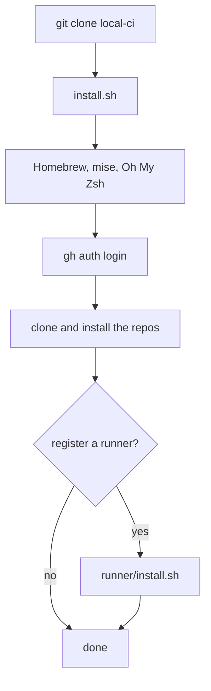
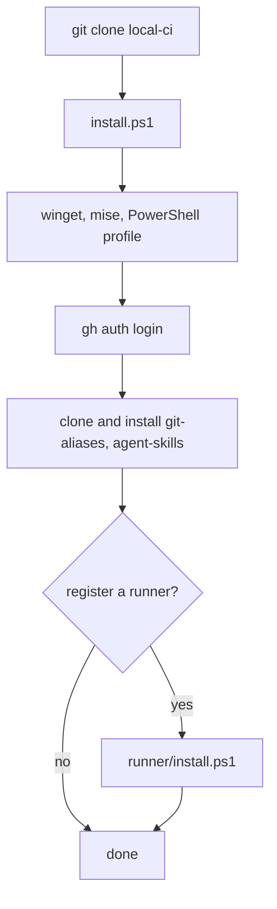
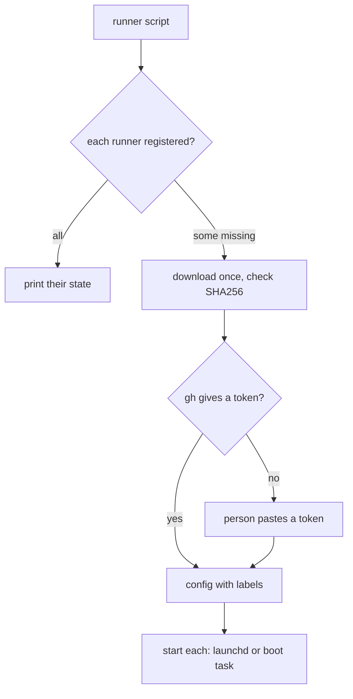
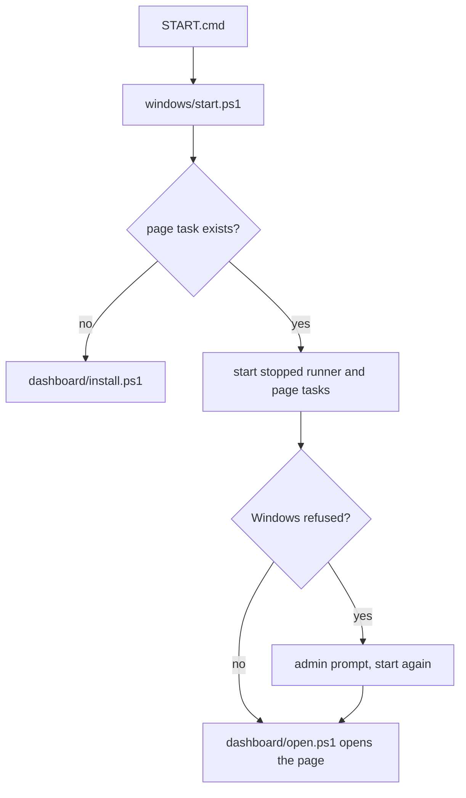
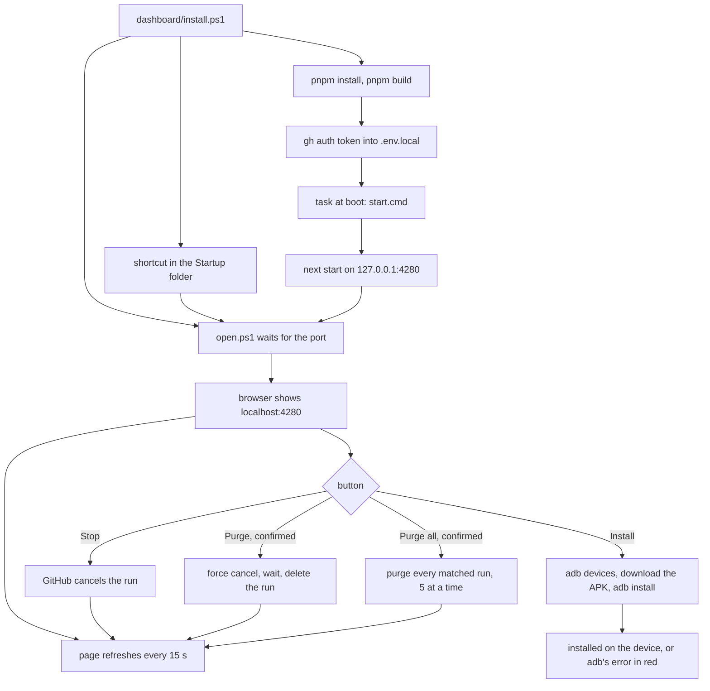

# User flows

## Set up a new Mac

1. Clone `workbench-soft/local-ci`, with a GitHub token as the password.
2. Run `./local-ci/install.sh`.
3. Give the git name and email when the script asks, then log into `gh`.
4. Say yes or no to the runner question.

## Set up a new Windows PC

1. Install Git: `winget install Git.Git`.
2. Clone `workbench-soft/local-ci`, with a GitHub token as the password.
3. In PowerShell, run `.\local-ci\install.ps1`.
4. Give the git name and email when the script asks, then log into `gh`.
5. Say yes or no to the runner question.

## Register a machine as a runner

1. Run `runner/install.sh` on a Mac, or `runner\install.ps1` on Windows.
   Set `RUNNER_COUNT` first for another number of runners.
2. Paste a registration token if the script asks for one.
3. Look under the org's Actions runners: each new runner shows as Idle.

## Start the CI with a double click

1. Open the `local-ci` folder in Explorer.
2. Double click `START.cmd`.
3. A window lists each runner and the page as running or started.
4. The browser opens `http://localhost:4280`. The window closes on its own,
   and stays open on an error.

## See the CI status

1. From the main checkout, run `.\dashboard\install.ps1` once.
2. Approve the admin prompt. The script builds the page and registers the
   `local-ci dashboard` task.
3. The browser opens `http://localhost:4280` once the page answers. It opens
   again at each logon.
4. Read the headline: how many jobs build on this PC and how many wait on
   GitHub. The Now card lists those jobs.
5. In Latest runs, pick a filter chip, type in the search box or click a
   column head to sort.
6. Press Stop on a run or a job to cancel its run. Press Purge and confirm to
   stop the run and delete it from GitHub. An error shows beside the buttons.
   To clear many runs, pick a filter or type a search, press Purge all and
   confirm. The count of purged runs and the first error show beside it.
7. A failed run names its failed job and step. Click it to read the log.
   Click the time in Took to see how long each job and step took.
8. Plug the phone in over USB with USB debugging on. Press Install in the
   Release column. The button says the device, or shows adb's error in red.
9. Click the branch or the PR link to open it on GitHub.

