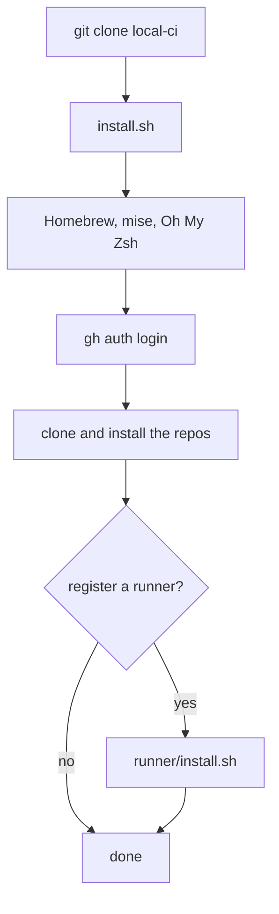
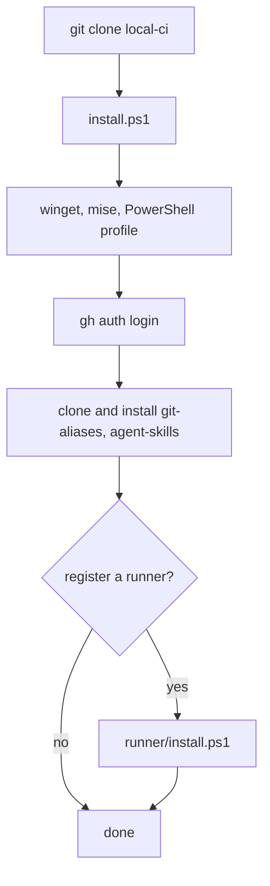
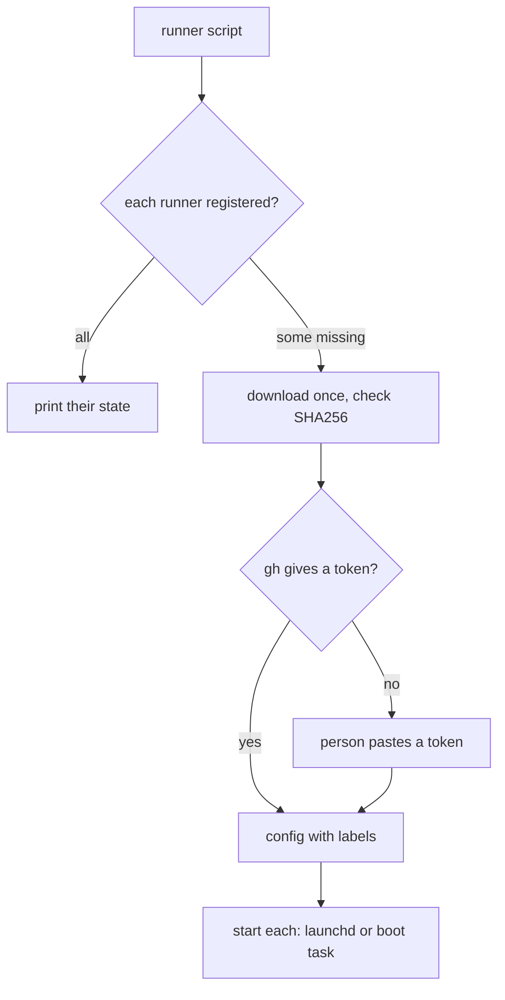
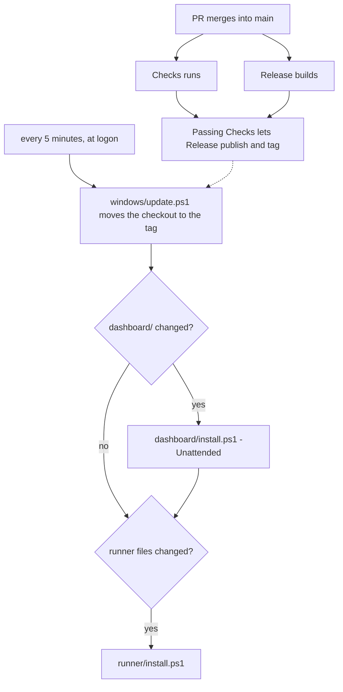
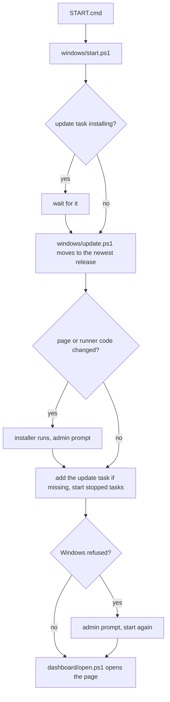
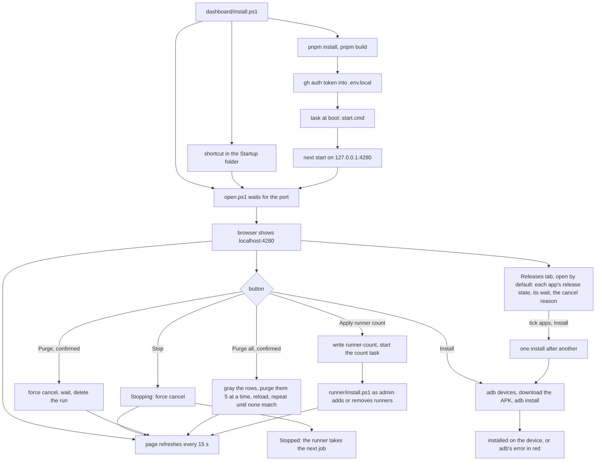

# User flows

## Set up a new Mac

1. Clone `workbench-soft/local-ci`, with a GitHub token as the password.
2. Run `./local-ci/install.sh`.
3. Give the git name and email when the script asks, then log into `gh`.
4. Say yes or no to the runner question.

## Set up a new Windows PC

1. Install Git: `winget install Git.Git`.
2. Clone `workbench-soft/local-ci`, with a GitHub token as the password.
3. In PowerShell, run `.\local-ci\install.ps1`.
4. Give the git name and email when the script asks, then log into `gh`.
5. Say yes or no to the runner question.

## Register a machine as a runner

1. Run `runner/install.sh` on a Mac, or `runner\install.ps1` on Windows.
   Set `RUNNER_COUNT` first for another number of runners.
2. Paste a registration token if the script asks for one.
3. Look under the org's Actions runners: each new runner shows as Idle.

## Get a new version installed

1. A PR merges into `main`.
2. Checks and Release start together. Publication waits for this commit's Checks.
3. Within 5 minutes the `local-ci update` task on the Windows PC runs.
4. The task moves the checkout to the new tag.
5. The task rebuilds the status page or reinstalls the runners when their
   files changed. `~/.local-ci/update.log` lists what ran.

## Start the CI with a double click

1. Open the `local-ci` folder in Explorer.
2. Double click `START.cmd`.
3. A window shows the release on disk. When the update task is installing,
   the window waits for it.
4. When the page or runner code changed, an admin prompt opens and the
   installer runs. The first run also adds the update task.
5. The window lists each runner and the page as running or started.
6. The browser opens `http://localhost:4280`. The window closes on its own,
   and stays open on an error.

## See the CI status

1. From the main checkout, run `.\dashboard\install.ps1` once.
2. Approve the admin prompt. The script builds the page and registers the
   `local-ci dashboard` task.
3. The browser opens `http://localhost:4280` once the page answers. It opens
   again at each logon.
4. Read the headline: how many jobs build on this PC and how many wait on
   GitHub. The Running now card lists those jobs.
5. In Latest runs, pick a filter chip, type in the search box or click a
   column head to sort.
6. Press Stop on a run or a job to cancel its run. The button reads
   Stopping, then Stopped, and its runner takes the next job. Press Purge
   and confirm to stop the run and delete it from GitHub. An error shows beside the buttons.
   To clear many runs, pick a filter or type a search, press Purge all and
   confirm. Its rows turn gray, and older runs move up and go too, until none
   match. The count of purged runs and the first error show beside it.
7. A failed run names its failed job and step. Click it to read the log.
   Click the time in Took to see how long each job and step took.
8. Plug the phone in over USB with USB debugging on. Press Install in the
   Release column. The button says the device, or shows adb's error in red.
   For several apps, read the Releases tab, the one the page opens on: each
   app says whether its release builds, waits, failed or was cancelled, how
   long the wait still is, and why a release stopped. Read what changed under
   Changes, tick the apps and press Install. Each row says Installed or
   shows adb's error. Press **Release on CI** to start a supported app's
   release workflow on `main`. Press **Build locally** to fetch and build the
   latest `main` for a supported Android app, then **Install local** to send
   its APK to the phone. A local build uses the app's local release key when
   available and leaves the source checkout unchanged.
9. To free GitHub Actions storage, on Releases press **Clean old APK releases & artifacts**.
   The page counts the eligible artifacts and older APK releases, explains what will remain,
   and asks for confirmation. Cleanup then runs in small batches. Active workflow artifacts
   and the newest published APK for every app stay available; run history is preserved.
10. Click the branch or the PR link to open it on GitHub.
   Open Cancellation history on either tab to read a saved stop reason.
   Follow its links to the replacement build, failed Checks, commit or PR.
11. To change the number of runners, type it in Runners on this PC, or press
    Use with the suggested count. Press Apply, and watch
    `runner\install.ps1` add or remove runners in its window.

