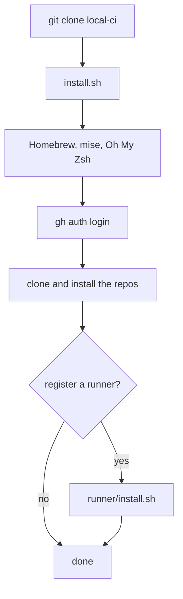
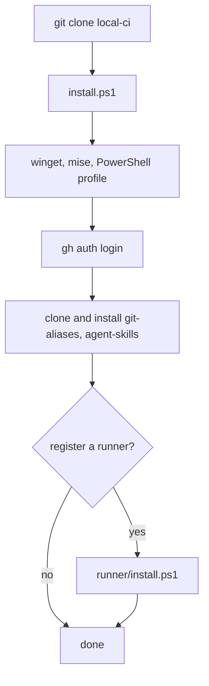
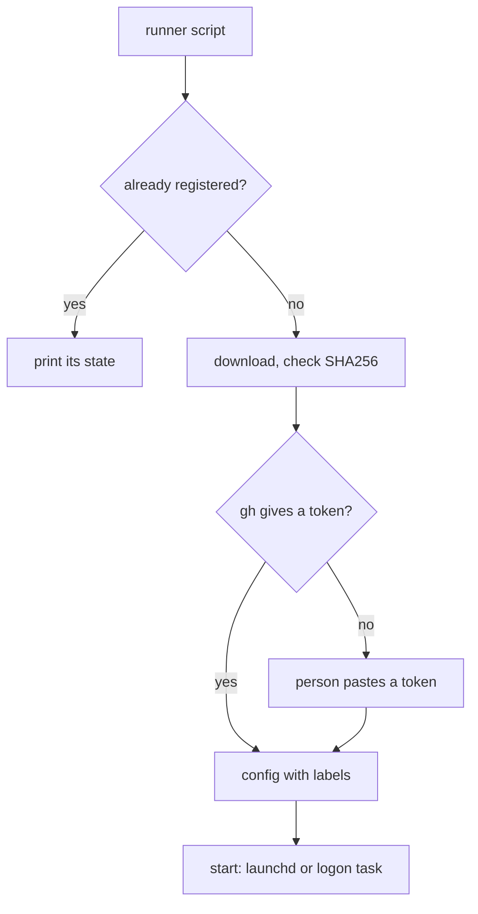
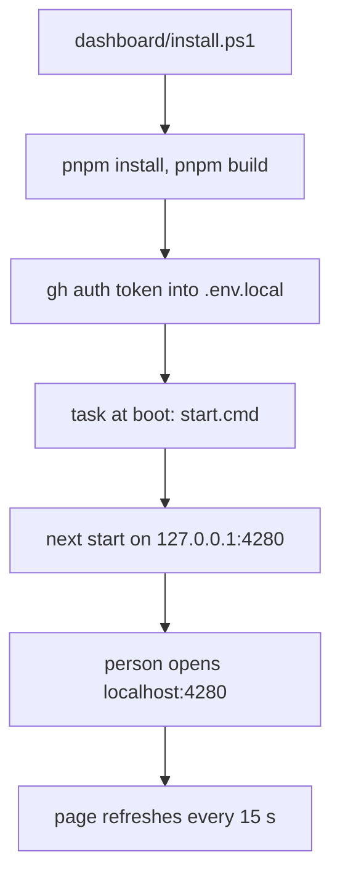

# User flows

## Set up a new Mac

1. Clone `workbench-soft/local-ci` with a GitHub token.
2. Run `./local-ci/install.sh`.
3. Type the git name and email when asked, then log into `gh`.
4. Answer the runner question.

## Set up a new Windows PC

1. Install Git: `winget install Git.Git`.
2. Clone `workbench-soft/local-ci` with a GitHub token.
3. Run `.\local-ci\install.ps1` in PowerShell.
4. Type the git name and email when asked, then log into `gh`.
5. Answer the runner question.

## Register a machine as a runner

1. Run `runner/install.sh` on a Mac or `runner\install.ps1` on Windows.
2. Paste a registration token if the script asks for one.
3. Check the runner shows as Idle under the org's Actions runners.

## See the CI status

1. Run `.\dashboard\install.ps1` once, from the main checkout.
2. Approve the admin prompt. The script builds the page and registers the
   `local-ci dashboard` task.
3. Open `http://localhost:4280`. After a reboot the page is there again.
4. The headline says whether the runner is up, builds or has a queue. The
   cards below show this PC, the org runners and the latest runs.

